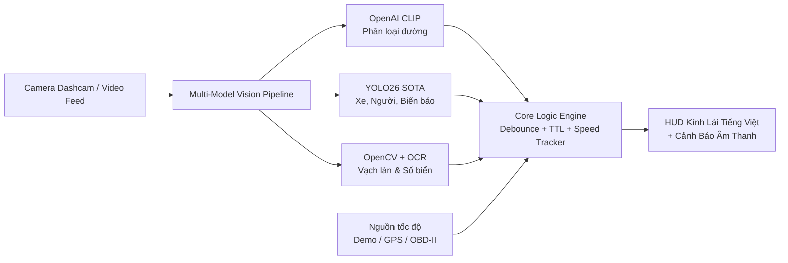

# Kịch Bản Thuyết Trình Dự Án ADAS Road Assistant
> **Tài liệu hướng dẫn báo cáo đồ án / thuyết trình kỹ thuật / demo sản phẩm**
> **Dự án:** ADAS Road Assistant — Hệ thống Hỗ trợ Lái xe Thông minh cho Giao thông Việt Nam  
> **Thời lượng đề xuất:** 5 – 7 phút thuyết trình + 3 – 5 phút Q&A

---

## MỤC LỤC
1. [Tổng Quan & Giá Trị Cốt Lõi](#1-tổng-quan--giá-trị-cốt-lõi)
2. [Cấu Trúc Slide & Lời Thoại (Speaker Notes)](#2-cấu-trúc-slide--lời-thoại-speaker-notes)
   - [Slide 1: Đặt Vấn Đề (The Hook)](#slide-1-đặt-vấn-đề-the-hook)
   - [Slide 2: Giải Pháp & Kiến Trúc Đa Tầng AI (Multi-Model AI)](#slide-2-giải-pháp--kiến-trúc-đa-tầng-ai-multi-model-ai)
   - [Slide 3: Dataset 82 Lớp Biển Báo Việt Nam](#slide-3-dataset-82-lớp-biển-báo-việt-nam)
   - [Slide 4: HUD Tiếng Việt & Đa Nguồn Tốc Độ (GPS / OBD-II)](#slide-4-hud-tiếng-việt--đa-nguồn-tốc-độ-gps--obd-ii)
   - [Slide 5: Hiệu Năng & Kiểm Thử Phần Mềm (Software Quality)](#slide-5-hiệu-năng--kiểm-thử-phần-mềm-software-quality)
   - [Slide 6: Lộ Trình Phát Triển (Roadmap)](#slide-6-lộ-trình-phát-triển-roadmap)
3. [Kịch Bản Live Demo Thực Tế (Từng Bước)](#3-kịch-bản-live-demo-thực-tế-từng-bước)
4. [Bộ Câu Hỏi Phòng Vệ & Phản Biện (Q&A Cheat Sheet)](#4-bộ-câu-hỏi-phòng-vệ--phản-biện-qa-cheat-sheet)
5. [Checklist Chuẩn Bị Trước Giờ G](#5-checklist-chuẩn-bị-trước-giờ-g)

---

## 1. TỔNG QUAN & GIÁ TRỊ CỐT LÕI

| Tiêu chí | Nội dung cốt lõi |
| :--- | :--- |
| **Tên dự án** | **ADAS Road Assistant** (Advanced Driver Assistance System) |
| **Vấn đề giải quyết** | Tình trạng chạy quá tốc độ, lơ là biển báo giao thông trong điều kiện đường sá phức tạp tại Việt Nam |
| **Điểm đột phá** | Kết hợp đa mô hình: **CLIP** (phân loại bối cảnh) + **YOLO26** (phát hiện đối tượng & biển báo) + **OpenCV/OCR** (làn đường & số biển báo) |
| **Bản địa hóa** | Dataset **10.159 ảnh, 82 lớp biển báo chuẩn QCVN 41**, HUD hiển thị tiếng Việt có dấu 100% |
| **Độ tin cậy** | Cơ chế chống báo động giả (Temporal Confirmation + Debounce + TTL), 39/39 Unit Tests pass |

---

## 2. CẤU TRÚC SLIDE & LỜI THOẠI (SPEAKER NOTES)



---

### Slide 1: Đặt Vấn Đề (The Hook)

* **Hình ảnh trên slide:** Hình ảnh giao thông đông đúc tại Hà Nội/TP.HCM (xe máy xen kẽ ô tô), biển báo tốc độ bị khuất sau tán cây hoặc xe buýt.
* **Ý chính:**
  - Tai nạn giao thông và việc bị phạt nguội do quá tốc độ phần lớn xuất phát từ việc tài xế không kịp quan sát biển báo.
  - Giao thông Việt Nam có tính đặc thù cao: biển báo đa dạng, mật độ phương tiện dày đặc, vạch kẻ đường nhanh mòn.
  - Các hệ thống ADAS nhập khẩu trên xe sang thường không tối ưu cho hệ thống biển báo đặc thù của Việt Nam.
* 🎙️ **Lời thoại gợi ý (Speaker Note):**
  > *"Kính thưa thầy cô và các bạn, tại Việt Nam, việc lơ là không quan sát kịp biển báo giới hạn tốc độ khi chuyển vùng từ cao tốc vào khu dân cư là nguyên nhân hàng đầu dẫn đến vi phạm và tai nạn. Các dòng xe cao cấp có tích hợp ADAS nhưng phần lớn được huấn luyện theo chuẩn Châu Âu hoặc Mỹ. Đó là lý do nhóm em phát triển **ADAS Road Assistant** — một giải pháp thị giác máy tính thông minh, được tối ưu riêng cho điều kiện đường sá và hệ thống biển báo giao thông Việt Nam."*

---

### Slide 2: Giải Pháp & Kiến Trúc Đa Tầng AI (Multi-Model AI)

* **Hình ảnh trên slide:** Sơ đồ kiến trúc 4 khối (Pipeline thị giác, Bộ lọc chống nhiễu, Nguồn tốc độ, Giao diện HUD).
* **Ý chính:**
  - Không dựa vào 1 mô hình đơn lẻ mà phối hợp đa công nghệ:
    1. **CLIP (Zero-Shot Transformer):** Nhận diện ngữ cảnh toàn cảnh (Đường đô thị, Cao tốc, Nông thôn, Khu dân cư...) mà không cần huấn luyện lại.
    2. **YOLO26 (Flagship SOTA):** Kiến trúc NMS-free và không dùng DFL, chạy nhanh hơn **43% trên CPU** so với thế hệ cũ. Dùng nhận diện ô tô, xe tải, xe máy, người đi bộ và ước lượng khoảng cách an toàn.
    3. **OpenCV + Tesseract OCR:** Xử lý Canny + Hough Transform nhận diện vạch làn đường với độ trễ siêu thấp (<5ms), kết hợp OCR đọc con số chính xác trên biển.
* 🎙️ **Lời thoại gợi ý:**
  > *"Thay vì dồn toàn bộ tác vụ vào một mô hình khổng lồ gây nghẽn phần cứng, chúng em thiết kế kiến trúc phân tầng. Tác vụ nhận diện vạch làn đường được giao cho OpenCV thuần với độ trễ chỉ 3 đến 5 mili-giây. Tác vụ nhận diện đối tượng và biển báo sử dụng YOLO26 — thế hệ SOTA mới nhất với ưu điểm NMS-Free, cho tốc độ xử lý trên CPU nhanh hơn tới 43%. Và mô hình CLIP được kích hoạt ngắt quãng mỗi 20 frames để phân loại bối cảnh toàn cảnh."*

---

### Slide 3: Dataset 82 Lớp Biển Báo Việt Nam

* **Hình ảnh trên slide:** Lưới ảnh các biển báo tiêu biểu (Biển 50, 60, 80 km/h, Cấm đi ngược chiều, Biển phân làn, Bắt đầu khu dân cư).
* **Ý chính:**
  - Đã tích hợp sẵn dataset chuẩn: **10.159 ảnh** và **10.157 file nhãn**.
  - Đầy đủ 82 lớp theo Quy chuẩn báo hiệu đường bộ QCVN 41.
  - Phân chia sẵn `train`, `val`, `test` với file cấu hình `data.yaml` chuẩn YOLO.
  - Đi kèm script huấn luyện tự động `train_yolo26_signs.py`.
* 🎙️ **Lời thoại gợi ý:**
  > *"Để hệ thống hiểu được đường phố Việt Nam, nhóm đã tích hợp trọn bộ dataset hơn 10.000 hình ảnh với 82 lớp biển báo: từ đầy đủ các mốc tốc độ 10 đến 120 km/h, cho đến biển cấm quay đầu, hết lệnh cấm và biển phân làn. Tất cả đã được lập chỉ mục song ngữ Anh - Việt và có sẵn pipeline huấn luyện mô hình YOLO26 trực tiếp."*

---

### Slide 4: HUD Tiếng Việt & Đa Nguồn Tốc Độ (GPS / OBD-II)

* **Hình ảnh trên slide:** Ảnh chụp màn hình HUD thực tế của xe chạy trên đường phố Hà Nội (HUD màu xanh/đen hiện đại, chữ tiếng Việt có dấu rõ nét).
* **Ý chính:**
  - **Pillow Typography Engine:** Khắc phục triệt để lỗi font tiếng Việt `???` thường gặp của OpenCV `putText`.
  - **Cơ chế chống báo động giả (Temporal Filter):** Một biển báo phải được đọc xác nhận liên tục nhiều khung hình trước khi cập nhật; tự động giải phóng biển theo thời gian hết hạn (TTL).
  - **Đa dạng cổng kết nối:**
    - Chế độ giả lập qua bàn phím (phục vụ kiểm thử & demo).
    - Cổng **GPS USB/Serial** (đọc bản tin NMEA $GPRMC để lấy tốc độ di chuyển thực tế).
    - Cổng **OBD-II/CAN-bus** (cắm trực tiếp dưới vô-lăng xe để đọc cảm biến vòng tua bánh xe).
* 🎙️ **Lời thoại gợi ý:**
  > *"Điểm đặc biệt ở trải nghiệm người dùng là giao diện HUD được vẽ bằng bộ dựng hình Pillow với font chữ tiếng Việt chuẩn Unicode, không bị lỗi font dấu hỏi. Về nguồn dữ liệu tốc độ, phần mềm hỗ trợ linh hoạt: từ chế độ phím bấm demo, đến việc cắm cổng GPS hoặc đọc trực tiếp từ ECU xe hơi qua giao thức chuẩn OBD-II."*

---

### Slide 5: Hiệu Năng & Kiểm Thử Phần Mềm (Software Quality)

* **Hình ảnh trên slide:** Ảnh chụp terminal chạy `pytest` với kết quả **39 passed** màu xanh lá.
* **Ý chính:**
  - Tốc độ xử lý thực tế: **25 – 30 FPS** ổn định trên CPU máy tính thông thường.
  - Tuân thủ tiêu chuẩn kỹ thuật phần mềm: tách biệt rõ ràng `core/`, `vision/`, `ui/`.
  - Bộ kiểm thử tự động **39 unit tests**: bao phủ toàn bộ logic tính toán giới hạn tốc độ, debounce, logger, parser cấu hình và dataset.
* 🎙️ **Lời thoại gợi ý:**
  > *"Một hệ thống an toàn trên xe hơi đòi hỏi độ tin cậy phần mềm tuyệt đối. Dự án đã được xây dựng hoàn chỉnh với bộ 39 bài kiểm thử đơn vị tự động, bao phủ từ logic kích hoạt cảnh báo, cơ chế debounce âm thanh cho đến tính toàn vẹn của dataset. Thời gian chạy trọn bộ test chỉ mất chưa tới nửa giây."*

---

### Slide 6: Lộ Trình Phát Triển (Roadmap)

* **Ý chính:**
  - Port pipeline sang phần cứng nhúng chuyên dụng: **NVIDIA Jetson Orin Nano**.
  - Tích hợp camera cảm biến góc rộng HDR chống lóa ban đêm.
  - Kết hợp bản đồ số offline (OSM/Here Maps) để đối chiếu giới hạn tốc độ khi biển báo bị mất hoặc che khuất hoàn toàn.

---

## 3. KỊCH BẢN LIVE DEMO THỰC TẾ (TỪNG BƯỚC)

Hãy chuẩn bị sẵn 2 cửa sổ Terminal trước khi thuyết trình:

### Cửa sổ 1: Mở màn với Video Đường Phố Hà Nội
Chạy lệnh:
```powershell
python -m adas --source "data/videos/vietnam_hanoi_street.webm" --manual-limit 50 --demo-speed 45
```

* **Thao tác 1 (Giới thiệu trạng thái bình thường):**
  - Chỉ vào góc trên HUD: *"Đây là phân loại cảnh đường: Đường đô thị (độ tin cậy 92%)."*
  - Chỉ vào vạch làn: *"Vạch kẻ đường màu xanh lá đang bám theo hướng di chuyển của xe."*
  - Tốc độ hiện tại: `45 km/h` / Giới hạn: `50 km/h` $\rightarrow$ Trạng thái an toàn màu xanh.
* **Thao tác 2 (Kích hoạt quá tốc độ):**
  - Nhấn phím `+` 2 lần: Tốc độ nhảy lên `55 km/h`.
  - **Hiện tượng:** Sau 0.5s debounce, bảng thông báo đổi sang **màu đỏ cảnh báo nhấp nháy: "QUÁ TỐC ĐỘ! (55 / 50 km/h)"**, đồng thời loa máy tính phát tiếng bíp ngắt quãng.
  - Giải thích: *"Hệ thống phát hiện vi phạm và lập tức cảnh báo cả thị giác lẫn thính giác cho người lái."*
* **Thao tác 3 (Hạ tốc độ về vùng an toàn):**
  - Nhấn phím `-` 2 lần: Tốc độ về lại `45 km/h` $\rightarrow$ Cảnh báo đỏ và âm thanh lập tức tắt.
  - Nhấn phím `q` để thoát video.

### Cửa sổ 2: Minh chứng độ tin cậy phần mềm (Code Quality Proof)
Chạy lệnh:
```powershell
pytest -q
```
* **Hiện tượng:** Màn hình trả về kết quả ngay lập tức: **`39 passed in 0.40s`**.
* Bình luận: *"Toàn bộ hệ thống lõi đã được kiểm chứng bằng 39 test tự động đạt chuẩn 100%."*

---

## 4. BỘ CÂU HỎI PHÒNG VỆ & PHẢN BIỆN (Q&A CHEAT SHEET)

> [!TIP]
> Đây là những câu hỏi mà ban giám khảo hoặc chuyên gia kỹ thuật hầu như luôn đặt ra. Hãy đọc kỹ các câu trả lời dưới đây để ghi điểm tối đa!

### Q1: Tại sao không dùng duy nhất một mô hình YOLO mà phải chia nhỏ thành CLIP, YOLO và OpenCV?
> **Trả lời:**
> *"Mỗi mô hình có thế mạnh và chi phí tính toán khác nhau. Nếu dùng một mô hình deep learning khổng lồ cho tất cả mọi thứ, hệ thống sẽ không thể đạt tốc độ thời gian thực (Real-time FPS) trên CPU hoặc thiết bị nhúng.
> - **OpenCV:** Xử lý vạch làn chỉ tốn ~3ms, hầu như không chiếm dụng tài nguyên.
> - **YOLO26:** Chuyên trách phát hiện bounding box đối tượng cục bộ với độ trễ cực thấp.
> - **CLIP:** Nhận diện ngữ cảnh toàn cảnh dạng zero-shot mà không cần phải gán nhãn hàng trăm nghìn ảnh đường sá thủ công.
> Sự phối hợp này tạo ra một kiến trúc cân bằng tối ưu giữa độ chính xác và hiệu năng."*

### Q2: Tại sao dự án nâng cấp lên YOLO26 thay vì dùng YOLOv8 hay YOLOv5 phổ biến?
> **Trả lời:**
> *"YOLO26 là thế hệ mô hình flagship mới nhất được Ultralytics công bố vào đầu năm 2026. Điểm đột phá lớn nhất của YOLO26 là kiến trúc **End-to-End NMS-Free** (loại bỏ hoàn toàn thuật toán lọc Non-Maximum Suppression phức tạp) và bỏ khối DFL ở detection head. Nhờ đó, việc export sang ONNX/TensorRT đơn giản hơn rất nhiều và tốc độ suy luận trên CPU nhanh hơn tới **43%** so với YOLOv8, đặc biệt lý tưởng cho các phần cứng nhúng trên ô tô."*

### Q3: Nếu biển báo bị mờ hoặc camera quét trúng biển quảng cáo tròn màu đỏ thì hệ thống có bị cảnh báo sai không?
> **Trả lời:**
> *"Hệ thống đã được trang bị 3 lớp bảo vệ chống nhiễu trong `SpeedLimitTracker`:
> 1. **Confidence Threshold:** Bỏ qua mọi ứng viên có độ tin cậy thấp.
> 2. **Temporal Confirmation Window:** Con số nhận diện từ OCR phải xuất hiện lặp lại ổn định trong nhiều frame liên tiếp trong cửa sổ thời gian 0.5s thì mới được coi là biển hợp lệ.
> 3. **Cơ chế TTL (Time-To-Live):** Biển tốc độ chỉ có hiệu lực trong một khoảng thời gian nhất định (mặc định 45s) rồi tự động thu hồi về giới hạn mặc định, tránh tình trạng lưu mãi một biển báo cũ khi xe đã đi sang đoạn đường khác."*

### Q4: Nếu triển khai ra sản phẩm thương mại thật trên xe hơi thì cần thêm những gì?
> **Trả lời:**
> *"Để thương mại hóa trên xe thực tế, lộ trình gồm 3 bước:
> 1. **Phần cứng:** Chuyển phần mềm lên bo mạch công nghiệp NVIDIA Jetson Orin Nano và camera cảm biến Sony IMX có dải động cao (HDR) để chống lóa đèn pha ban đêm.
> 2. **Dữ liệu xe:** Kết nối cổng OBD-II lấy trực tiếp tín hiệu tốc độ xe từ bus CAN.
> 3. **Bản đồ số:** Tích hợp dữ liệu GPS bản đồ ngoại tuyến để đối chiếu chéo khi gặp thời tiết xấu hoặc biển báo bị che lấp."*

---

## 5. CHECKLIST CHUẨN BỊ TRƯỚC GIỜ G

- [ ] Đã kiểm tra môi trường ảo `.venv` hoạt động bình thường.
- [ ] Chạy thử lệnh `pytest` đảm bảo **39/39 tests đều pass**.
- [ ] Kiểm tra video demo trong `data/videos/vietnam_hanoi_street.webm` mở bình thường.
- [ ] Kiểm tra âm thanh loa ngoài của máy tính (để nghe rõ tiếng bíp khi quá tốc độ).
- [ ] Tăng độ sáng màn hình và mở font size của Terminal lớn hơn bình thường (khoảng cỡ 18-20) để người ngồi dưới hội trường dễ đọc.
- [ ] Mở sẵn slide PowerPoint và chuẩn bị phím tắt chuyển nhanh giữa slide và terminal (`Alt + Tab`).
